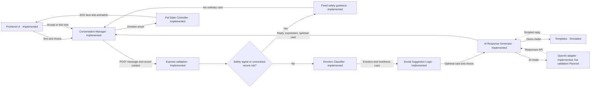

# PawPal current system architecture

Recorded: 17 November 2026. Based on implemented source code, rather than the Phase 2 plan.

See the [standalone SVG architecture diagram](architecture-current.svg). The original FigJam architecture remains a design-stage plan. An attempt to append the implementation diagram to that file was rejected by the Figma MCP Starter tool-call quota; it was not synchronised successfully.

## Six modules and their locations

| Module | Location | Current status |
| --- | --- | --- |
| Frontend UI | `src/App.tsx`, `src/styles.css` | Implemented: responsive chat, input, loading, errors and suggestion controls |
| Conversation Manager | `src/hooks/useConversation.ts`, `server/conversation.ts` | Implemented: tab memory, context, retry and routing |
| AI Response Generator | `server/ai/demo.ts`, `server/ai/openai.ts` | Routing and adapters Implemented; Demo replies Simulated; live end-to-end validation Planned |
| Emotion Classifier | `server/logic/emotion.ts` | Implemented: rules and recent context; not diagnosis |
| Pet State Controller | `src/hooks/useConversation.ts`, `src/components/Pet.tsx`, CSS | Implemented: one shared SVG with four expressions and animations |
| Social Suggestion Logic | `server/logic/social.ts`, `src/hooks/useConversation.ts` | Implemented: server decides eligibility; client retains acceptance or refusal |

## Data and control flows

Solid arrows represent messages, context, results or choices; dashed arrows represent returns from reply-generation branches. These are six logical modules, not six independent services. The system consists of a React browser application and one Express process, without a database, queue or additional service.

Input is validated before safety routing. Normal requests use emotion and context to determine suggestion eligibility, then use the explicit mode to select scripted replies or the model adapter. Successful responses contain reply text, an expression and an optional card. The serious-risk branch returns fixed safety guidance and bypasses ordinary suggestions and model calls.

Accept and Not now produce local fixed feedback and retain the choice for subsequent requests. There are no social-platform APIs, outgoing messages or background reminders. The server does not persist conversations; the client sends at most twelve recent messages as context. In AI mode, the external data flow is from the server to OpenAI, using a server-side key.

## Status labels

- **Implemented:** code exists. See `TEST_RESULTS.md` for the verified scope; this does not imply validation in every environment.
- **Simulated:** Demo reply text comes from templates. Chat, expression changes, suggestion decisions and error handling use executable application logic.
- **Planned:** live integration testing with an API key, Figma prototype connections, the FigJam implementation update, user testing and final acceptance.
