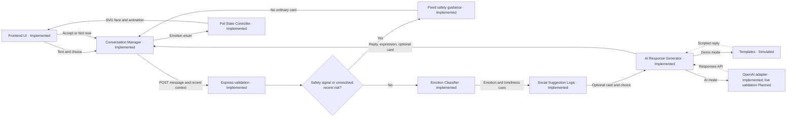

# PawPal 当前系统架构

日期：2026-11-17。依据实际源代码，而非 Phase 2 的计划图。

查看 [独立 SVG 架构图](architecture-current.svg)。FigJam 原架构文件仍是设计阶段计划；尝试向同一文件追加实现图被 Figma MCP Starter 调用额度拒绝，没有声称同步成功。

## 六个模块与实际位置

| 模块 | 位置 | 当前状态 |
| --- | --- | --- |
| Frontend UI | `src/App.tsx`、`src/styles.css` | Implemented；响应式聊天、输入、加载、错误、建议按钮 |
| Conversation Manager | `src/hooks/useConversation.ts`、`server/conversation.ts` | Implemented；标签页内存、上下文、重试和路由 |
| AI Response Generator | `server/ai/demo.ts`、`server/ai/openai.ts` | 路由与适配器 Implemented；Demo 回复 Simulated；真实端到端验证 Planned |
| Emotion Classifier | `server/logic/emotion.ts` | Implemented；规则与近期上下文，不是诊断 |
| Pet State Controller | `useConversation.ts`、`components/Pet.tsx`、CSS | Implemented；同一 SVG 四种状态与动画 |
| Social Suggestion Logic | `server/logic/social.ts`、`useConversation.ts` | Implemented；服务端决定是否建议，前端保留接受/拒绝选择 |

## 数据流与控制流

实线表示消息、上下文、结果或用户选择；虚线表示回复生成分支返回。六个模块不是六个独立服务：浏览器 React 应用加一个 Express 进程，没有数据库、队列或额外服务。

每次输入先验证，再进行安全路由。正常请求根据情绪与上下文判断建议资格，再由显式模式选择脚本或真实模型，成功后统一返回回复、表情和卡片。严重风险分支返回固定安全指导并跳过普通建议与模型调用。

Accept / Not now 只生成本地固定反馈并保留选择，后续请求携带该选择。没有社交平台 API、消息发送或后台提醒。服务器当前不保存会话；前端至多发送 12 条上下文。AI 模式的外部数据流仅为服务器到 OpenAI，使用服务端 key。

## 状态说明

- **Implemented**：代码已存在；已验证的范围见 `TEST_RESULTS.md`，不意味着所有运行环境已通过。
- **Simulated**：Demo 的回复文本由模板生成；聊天、表情切换、建议按钮和错误处理使用实际交互逻辑。
- **Planned**：真实 API key 下的联调、Figma 原型连线、FigJam 实现图同步、用户测试与最终验收。
